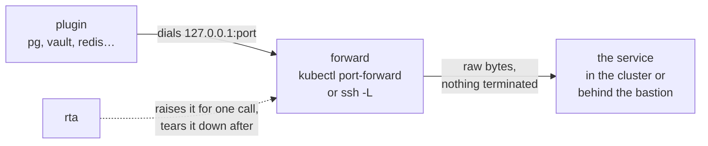

# Reaching private services

Most of what a profile points at is not on your machine: a database in a cluster, a Vault behind a bastion. A connection can say how to get there, and rta raises the path for the one call that needs it.

A forward is a raw byte pipe that rta raises for one call and tears down afterwards. The plugin dials an ordinary local address and never learns a tunnel was there:



## Naming the path

```yaml
profiles:
  staging:
    plugins:
      pg:
        kube: staging/db/svc/postgres:5432
```

A call filled from that connection runs through a `kubectl port-forward` that rta raises and tears down again. The plugin sees an ordinary local address and never learns a tunnel was there — which is why no service plugin needs changing to gain this.

```yaml
profiles:
  staging:
    plugins:
      pg:
        ssh: bastion.example.com/db.internal:5432
```

The same fact, spelled for a service behind a jump host rather than in a cluster. The head is an `~/.ssh/config` alias, and everything your SSH config says about it keeps working — rta shells out to `ssh`.

One forward per call, torn down afterwards. A cached port-forward outlives the pod it points at, and a stale tunnel to a rescheduled pod fails in a way nobody can read. While it is up, a forward is a port on `127.0.0.1` that any account on this machine can connect to, as the same `kubectl port-forward` or `ssh -L` typed by hand is: on a machine you share with other people, a service that trusts where a connection comes from — a redis with no password, an internal HTTP API — is reachable by them for the length of the call. Give such a service a credential of its own, or reach it from a machine you do not share.

A forward is also torn down when the server that opened it is killed outright: on Linux the kernel ends it with its parent, and on macOS, which has no such signal, the next `rta mcp serve` finds what a killed one left in `forwards/` under the data directory and stops it — only when the process that started it is gone and the pid still has the start time that was written down, so a pid the kernel has reused is never signalled. Until then a forward left by a `kill -9` is a loopback listener into the cluster; `rta mcp serve` says on its stderr how many it stopped.

A connection states **at most one** of `kube` and `ssh`; both at once is refused.

## Once, without writing a profile

Most of what you do against a database in a cluster is not worth a profile: look at the replication of the one in `databases`, once, now. The choice used to be a profile written for the purpose, or `kubectl port-forward` and `psql` and a password copied by hand — which is how a credential reaches a shell history. The same connection can be stated on the command line of the one call:

```bash
rta pg replication status --kube staging/databases/svc/postgres:5432 --secret password=kube:postgres-app/password --user app
rta redis overview --secrets-from staging/cache --secret password=kube:redis/password --address redis.internal:6379
```

`--kube` is the coordinate a profile's `kube:` is, and the forward is raised for this call and torn down after it. `--secret <input>=<reference>` is a profile's `secrets:`: `kube:<secret>/<key>` reads the credential from the Secret in the namespace the coordinate names, `kv:<entry>` from the local store, and what is on the line is the reference and never the credential — a value in its place is refused, saying that it is in your shell's history now. A service reached directly, with only its credential in the cluster, says which cluster holds the Secret with `--secrets-from <context>/<namespace>` instead, as a profile's `secrets-from:` does. Everything else about the connection is the capability's own flags, as it is for a profile.

It is held to what a stored connection is held to — a coordinate that does not parse, a credential mapped onto an input the plugin does not have, a `kube:` reference that does not say which cluster, a plugin that declares no input a forward could fill — because the checks are the profile's own, called from one place, so a stored connection and a typed one cannot disagree about what is valid. The line above the result says where it went (`● ad hoc — through staging/databases/svc/postgres:5432`), over whatever `rta use` has switched on, and the connection is named `ad hoc` wherever a result names the environment it came from: a hint that would paste the call back names it, and a profile cannot be called that, so the paste fails where it is pasted and does not reach somewhere else. In the [TUI](./20-tui.md#a-connection-for-the-session) it is the entry after the environments in the environment picker, `ad hoc connection…`, which asks for the same things and holds the answer until the TUI quits. Combined with `--profile` the flags are refused, since the two are different answers to where the call goes. `--no-profile` is the flag that says only the second half — leave the environment that is switched on, state the rest yourself — and it is accepted beside them, since it says nothing different. Nothing is written, and no `RTA_PROFILE_*` variable is read: those belong to a profile, and a variable exported for a profile called `ad-hoc` would otherwise spell the same name and reach a call aimed somewhere else. `rta profile set staging --plugin pg --kube ...` keeps one that turns out to be worth keeping.

**It is a person's act, on a person's machine, and nobody else's.** The flags are on the command line and on no tool an agent is offered: an agent cannot name a cluster, a Service or a Secret, and a call that sends one of these names is refused as it would refuse any name the tool does not have. Over [MCP](../95-reference/10-glossary.md#acronyms) a connection is a profile, named by something a person consented to; typing `--kube` in your own shell is that person, who already holds the kubeconfig the forward uses. Nothing here is a grant, and none of it is recorded as an agent's call.

## When the far side speaks TLS on its own

```yaml
profiles:
  homelab:
    plugins:
      vault:
        kube: homelab/vault-operator-system/svc/vault:8200
        tunnel-tls: true
        set:
          ca-file: ~/.config/homelab/vault-ca.crt
          tls-server-name: vault.vault-operator-system.svc
```

`kubectl port-forward` and `ssh -L` are both a raw byte pipe from `127.0.0.1` straight into whatever the destination socket speaks — neither terminates a request the way a proxy would. So the plain `http://` a forward fills in by default is correct for the ordinary case (a plaintext service behind a TLS-secured cluster or bastion hop) and silently wrong for a service whose own listener speaks [TLS](../95-reference/10-glossary.md#acronyms), Vault's being the common example: the forward carries the TLS bytes through unchanged, and a plain HTTP client sending a request into them gets a connection that closes with nothing readable back.

Keep the `ca-file` outside rta's own directories (`~/.config/rta` and `~/.local/share/rta`): a plugin runs in a sandbox that cannot read them, and the call fails with the file unreadable.

A copy keeps the dates it was copied with, and a [CA](../95-reference/10-glossary.md#acronyms) that renews in place — CloudNativePG's own lasts ninety days — leaves the copy behind. A plugin that declares its connection with the SDK's `plugin.Service` says so rather than calling the server untrusted: a `ca-file` whose every certificate has expired is refused before anything is dialled, and a server signed by a CA whose copy there has expired is refused by that copy's date, both as `<plugin>.tls.ca.expired`. Export the CA again from where it is kept.

`tunnel-tls: true` says the far end terminates TLS itself, so the forward should be addressed as `https://` — refused if the connection states neither `kube:` nor `ssh:`, since there is then no forward for it to describe, and for a plugin that takes no URL, since a URL is all it changes: etcd, redis and the databases turn TLS on through a forward with their own `tls-server-name` or `ca-file`. It changes *scheme only*. Certificate verification still runs as normal, against whatever this machine already trusts or the `ca-file` the connection names, and `tunnel-tls: true` does not become `--insecure` under any configuration: a self-signed or cluster-internal [CA](../95-reference/10-glossary.md#acronyms) (an operator-generated root, a private issuer) is a certificate nothing here vouches for, which a plugin that declares its connection with the SDK's `plugin.Service` trusts on first use through a `kube:` forward, as [below](#a-certificate-nothing-here-vouches-for) says, and any other refuses.

The name is checked too, and through a forward the address the plugin dials is `127.0.0.1`, which a server's certificate names only when it was issued to answer probes on loopback as well. A certificate made for the service — `vault.vault-operator-system.svc` above — is refused for its name, and the refusal says the forward is why. `tls-server-name` is the name to check it for instead, the one the service's certificate was issued under: `etcd`, `keycloak`, `qdrant`, `redis`, `s3` and `vault` take it, as a setting only an operator states, and an agent cannot change it. The chain is still checked in full, against the CA the profile names.

### A certificate nothing here vouches for

A plugin that declares its connection with the SDK's `plugin.Service` checks a server's certificate as it always did first: against this machine's roots, or against the `ca-file` the connection names. When nothing vouches for it and no CA is named — a self-signed appliance, a cluster's own CA, a certificate that expired — rta remembers what the server presented, the way ssh learns a host key, rather than offering a switch that turns the check off:

- **Through a `kube:` forward**, the first certificate is trusted as it arrives, and the call is made again with it. The path there is kubectl's own tunnel into the pod, which a network between you and the cluster cannot sit on, and the coordinate is yours, which no agent can name. The profile above reaches its Vault with `tunnel-tls: true` alone, the `ca-file` and `tls-server-name` left out.
- **Anywhere else** — a server reached directly, or through `ssh:` — the first call is refused, and the certificate kept. `rta cert trust <server>` shows it, with the `sha256` digest `rta cert inspect` prints, and trusts it on your yes; the refusal names that command, and tells an agent to ask the operator. Silent there, a network that answers your DNS and your gateway — a café's Wi-Fi — would have its own certificate kept for a server that normally has a valid one, and the credential handed over with the first call.

After that, the server presenting the very certificate trusted is reached whatever its dates say, and one renewed by a CA it came with passes too, held to its dates and to the name the call checks. Anything else is refused as `<plugin>.tls.changed`, its certificate kept beside the one it would replace, and waits for `rta cert trust` — forward or not. `rta cert trusted` lists what is trusted, when and how, and what waits; `rta cert forget <server>` takes one back. None of the three is a tool an agent is offered, and what is trusted is sealed like a grant, since it decides where a plugin sends its credential.

A CA named is the only issuer that vouches on its connection: nothing trusted stands in beside a `ca-file`, and a server it does not vouch for is refused as ever. What this does not cover is several replicas behind one address with a self-signed certificate each (the first is trusted and every other refused as a change), a certificate regenerated on every start (each start waits again), and a hosted server, where nobody answers at a terminal: there, `ca-file` is the way.

**Named apart from any plugin's own `tls` or `sslmode`.** etcd, qdrant and s3 each read `set: {tls: ...}`; pg reads `set: {sslmode: ...}` — that is the plugin's *own* on/off toggle, in its own client library's vocabulary, and the host forces it off over a tunnel (see [Types are part of the declaration](./41-profiles-in-depth.md#types-are-part-of-the-declaration) for that mechanism). `tunnel-tls` is a different fact at a different layer: not a plugin's setting, but what the host must know about the coordinate itself to address it correctly, before any plugin config is even read. The two can sit beside each other in the same entry without conflict — they answer different questions — but they would not if they shared a word.

Where that CA lives is a plugin's own concern rather than the tunnel's, because reading it is a file-read primitive and the plugin declares — or does not — that it trusts a caller-named path for it: a PEM bundle read from this machine, never from the cluster, and never fillable by an [MCP](../95-reference/10-glossary.md#acronyms) caller. `rta explain <capability>` lists whether a given plugin offers one. Not a secret either — a CA certificate is the public half of a key pair, the half a CA hands out for wide distribution so anyone can verify what it signed, the same reason an OS trust store ships thousands of them in the clear. It needs no more protection than `address` does, and reading it through `kv:`/`kube:` the way a credential is would be reaching for the wrong tool.

The field is named for what it mirrors, plugin by plugin, rather than one word forced everywhere:

| Plugin | Field | Why that name |
| --- | --- | --- |
| `etcd`, `vault`, `s3`, `qdrant` | `ca-file` | No existing library vocabulary to mirror, so these four agree with each other instead |
| `pg` | `sslrootcert` | Its own `sslmode` already commits this plugin to libpq's vocabulary, and `sslrootcert` is libpq's own keyword for exactly this — pgx's DSN parser reads it directly |

**Over `kube:` or `ssh:`, `pg` reads a CA, a client certificate or a name to check as a request for TLS.** A tunnelled connection forces `sslmode` to `disable`: `sslmode` carries `plugin.EndpointTLS`, the role a forward's own hop takes over unconditionally (the same mechanism etcd's, qdrant's and s3's own `tls` field go through, and the reasoning is the same one — PostgreSQL's TLS kills a `kubectl port-forward` on the clean disconnect). A profile that states `sslmode` beside `kube:` or `ssh:` is refused as overridden by the forward, and so is `--sslmode` given on a call that goes through one with any value but `disable` (`core.profile.tls.forward`). `sslrootcert`, `sslcert`, `sslkey` and `tls-server-name` are not refused beside the forward, because each is a request for TLS that nothing else on the line answers, and `pg` turns it on at `verify-full`: the one mode that checks the name, which the forward's end, `127.0.0.1`, is not, so `tls-server-name` is the name to check it for. Through a `kube:` forward a query or a schema works over that TLS, and a dump or a restore is refused (`pg.tls.client.forward`), because each connects twice and the forward ends when the first TLS connection closes; an `ssh:` forward is a long-lived tunnel and ends no such way.

For a directly-reached server — a managed Postgres, an on-prem instance with no forward in front of it — `sslmode` is exactly what `set:` states:

```yaml
profiles:
  managed:
    plugins:
      pg:
        set:
          host: pg.example.internal
          sslmode: verify-ca
          sslrootcert: ~/.config/homelab/pg-ca.crt
```

A client certificate and key are `sslcert` and `sslkey`, named the same way. `ssl-home: true` is the opt-in for the habit libpq has of looking under `~/.postgresql` for all three when they are not named: with it on, `pg` uses what is there, resolved once and handed both the driver and `pg_dump`, `psql` and `pg_restore`, so they cannot disagree; it is off by default so that no file is read that a setting did not name, and it is never fillable by an MCP caller.

**`sslmode` does not follow `sslrootcert`, and a CA beside a mode that would not verify against it is refused.** `sslmode`'s own default, `prefer`, never verifies the server in pgx whatever CA it is given, and libpq — which `pg_dump`, `psql` and `pg_restore` run on — verifies under it and then retries in plaintext when verification fails; `require` verifies only because a file is there, and stops without a word the day the file is dropped. So a CA beside either is refused before anything dials, as `pg.tls.ca.unused` and `pg.tls.ca.implied`, naming the mode to set instead: `verify-ca` checks the server's chain against the CA, and `verify-full` its name as well. `verify-ca` with no `sslrootcert` is refused too, since pgx would then check the chain against this machine's own store and read no name, and `sslrootcert: system`, this machine's own store, is taken beside `verify-full` alone. This is deliberate rather than a gap: which axis to move — the CA, how strict to be about it — is two separate decisions, and silently elevating one because the other was set would be a second, undocumented way `sslmode`'s value changes (the codebase already argues against exactly that kind of surprise — see [Types are part of the declaration](./41-profiles-in-depth.md#types-are-part-of-the-declaration)), so the refusal says which mode to set rather than setting it. Set both, as above.

## Related

- [Profiles](./40-profiles.md) — the everyday page
- [Profiles in depth](./41-profiles-in-depth.md) — instances, types, and the other half of the TLS rules
- [Kubernetes](../30-boundary/80-kubernetes.md) — the same idea one level up, for the server an agent reaches

## Next

[Secrets](./50-secrets.md) — what `kv:` references point at.
